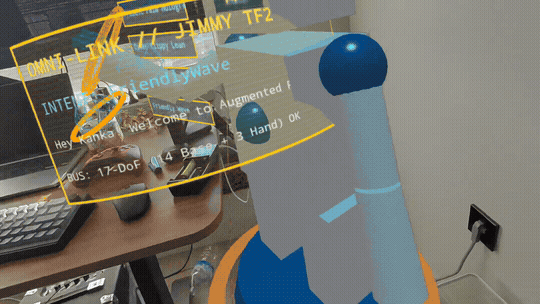
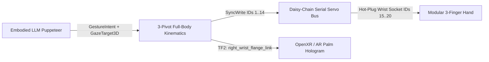

# Jimmy (`ar-bot-jimmy`) — 38 cm Modular Full-Body ROS 2 + AR Humanoid Companion



**Jimmy** is a 38 cm (1.5-span) desktop mini-humanoid companion robot combining **ROS 2 full-body 3-pivot kinematics**, **daisy-chain serial bus actuators**, an **Embodied LLM Puppeteer** (modern Cyber-Clippy persona), and an **OpenXR / Augmented Reality spatial hologram layer**.

## System Architecture



## Subsystem & Phase Matrix

| Phase | Subsystem | Core Artifact | Status |
| :--- | :--- | :--- | :--- |
| **Phase 1** | MBSE & 3-Pivot Kinematics | [`MBSE_MODEL.md`](docs/architecture/MBSE_MODEL.md), [`jimmy_full_body.urdf.xacro`](ros2/jimmy_description/urdf/jimmy_full_body.urdf.xacro), [`kinematics.rs`](crates/jimmy-core/src/kinematics.rs) | Verified |
| **Phase 2** | Serial Bus Servo Bridge | [`bus.rs`](crates/jimmy-core/src/bus.rs) (`ActuatorBus` trait & thermal guard) | Verified |
| **Phase 3** | Embodied LLM Puppeteer | [`puppeteer.rs`](crates/jimmy-core/src/puppeteer.rs) (`CyberClippyLean`, `PresentPalmHologram`) | Verified |
| **Phase 4** | OpenXR / AR Spatial Link | [`ar_anchor.rs`](crates/jimmy-core/src/ar_anchor.rs), [`web/index.html`](web/index.html) (Mass Effect Omni-HUD) | Verified |
| **Phase 5** | Modular 3-Finger Hand | [`hand.rs`](crates/jimmy-core/src/hand.rs) (`ThreeFingerHand` + compliant grasp torque limit) | Verified |
| **Phase 6** | Expressive Visor & 3D Fingers | [`visor-face.js`](web/visor-face.js), [`jimmy-model.js`](web/jimmy-model.js) (Blinking eyes & 3D phalanges) | Verified |
| **Phase 7** | 3-Pivot Inverse Kinematics | [`ik.rs`](crates/jimmy-core/src/ik.rs) (`solve_right_arm_ik` closed-form desk reach solver) | Verified |
| **Phase 8** | Quest 3 3D Laser & Holo-Menu | [`holo-menu.js`](web/holo-menu.js), [`xr-app.js`](web/xr-app.js) (3D spatial menu & controller raycaster) | Verified |
| **Phase 9** | Live LLM Chat & ROS 2 Bridge | [`llm-chat.js`](web/llm-chat.js), [`ros2_bridge.rs`](crates/jimmy-core/src/ros2_bridge.rs) (`Ros2JointState17` `/joint_states`) | Verified |
| **Phase 10** | Telemetry & Control Daemon | [`crates/jimmy-daemon/`](crates/jimmy-daemon/src/main.rs) (`127.0.0.1:8765` live JSON & IK endpoint) | Verified |
| **Phase 11** | Quest 3 Spatial Grab-and-Place | [`spatial-grab.js`](web/spatial-grab.js) (Grip squeeze placement & Desk Anchor Ring) | Verified |
| **Phase 12** | Interactive 3D IK Target Orb | [`ik-target.js`](web/ik-target.js) (Real-time 3-pivot arm & gaze tracking orb) | Verified |
| **Phase 13** | Hardware Harness & Servo ID | [`WIRING_AND_BRINGUP.md`](docs/hardware/WIRING_AND_BRINGUP.md), [`protocol.rs`](crates/jimmy-core/src/protocol.rs) (`encode_set_servo_id`) | Verified |
| **Phase 14** | GitHub Actions CI & Matrix | [`.github/workflows/ci.yml`](.github/workflows/ci.yml) (`12/12` workspace unit tests) | Verified |

## Meta Quest 3 WebXR Passthrough & Mass Effect Omni-HUD

Open directly in **Meta Quest 3 Browser** (HTTPS WebXR `immersive-ar`) or desktop browser:
- **Live WebXR App:** `https://gokselozgur5.github.io/ar-bot-jimmy/web/`
- **Local Preview:** `python3 -m http.server 8080 --directory web` (`http://localhost:8080`)

## Hardware & Kinematic Highlights

- **3-Point Spherical Pivots:** 3-DoF Waist (Roll/Pitch/Yaw), 3-DoF Neck/Visor, and Dual 6-DoF Arms (3-pivot shoulder + elbow + 2-DoF wrist socket).
- **Single-Cable Daisy-Chain Bus:** UART/RS-485 smart bus servos (`IDs 1..=14`) eliminate harness clutter and expose a pass-through 3-pin wrist header for plug-and-play finger upgrades (`IDs 15..=20`).
- **Weighted Wheeled-Leg Base:** Battery mass sits inside the wide foot base so aggressive upper-body gestures never tip the robot.

## Verification

```bash
cargo test --workspace
```
