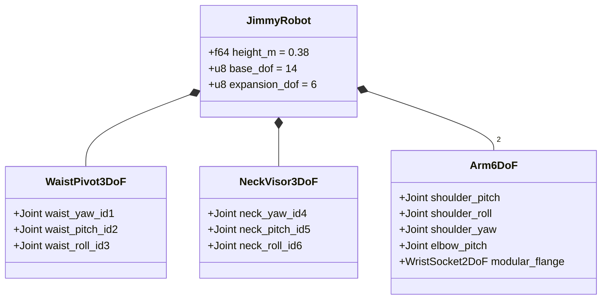

# Jimmy Full-Body AR Companion — MBSE System Model

## 1. Block Definition Diagram (SysML BDD)

## 2. Daisy-Chain Serial Bus Interface Control (ICD)

| Subsystem | Servo IDs | DoF | Bus Protocol | Mechanical Interface |
| :--- | :--- | :--- | :--- | :--- |
| **Waist 3-Pivot** | `1..=3` | 3 | UART/RS-485 1 Mbps | Heavy Wheeled Foot Base |
| **Neck + Visor** | `4..=6` | 3 | UART/RS-485 1 Mbps | IPS Visor + Chest Wide Cam |
| **Left Arm** | `7..=10` | 4 | UART/RS-485 1 Mbps | Magnetic/4-Bolt Wrist Flange |
| **Right Arm** | `11..=14` | 4 | UART/RS-485 1 Mbps | Magnetic/4-Bolt Wrist Flange |
| **3-Finger Hands** | `15..=20` | 6 | Hot-Plug Daisy-Chain | Pass-through 3-Pin Bus Header |
