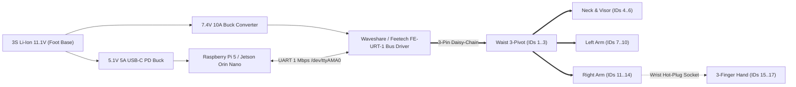

# Jimmy Hardware Wiring Harness, Power Budget & Servo ID Provisioning

## 1. Power & Serial Bus Topology

## 2. Electrical Current & Thermal Budget

| Rail | Voltage | Continuous Current | Peak Current | Protected Subsystem |
| :--- | :--- | :--- | :--- | :--- |
| **Actuator Bus** | `7.4 V` | `1.8 A` | `8.5 A` | 14× STS3215 Base + 6× Micro Hand Servos |
| **Compute & Vision** | `5.1 V` | `2.2 A` | `4.0 A` | Raspberry Pi 5 + Wide CSI Camera + 2.4" SPI Visor |

## 3. One-By-One Servo EEPROM ID Provisioning
Connect a single unconfigured factory servo (`ID = 1`) to the bus and transmit `encode_set_servo_id(1, target_id)` from `jimmy_core::protocol` before daisy-chaining the next joint.
